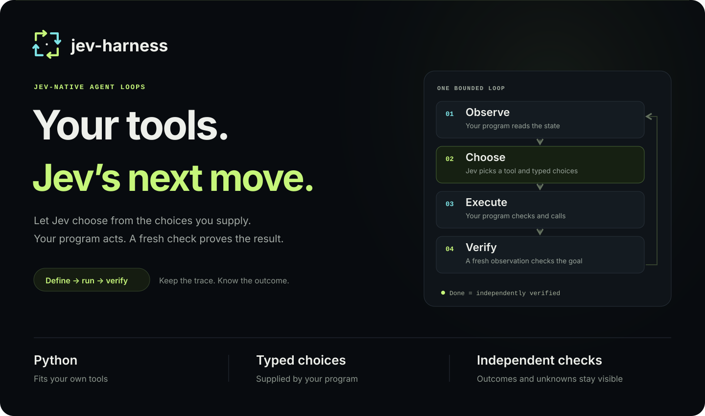
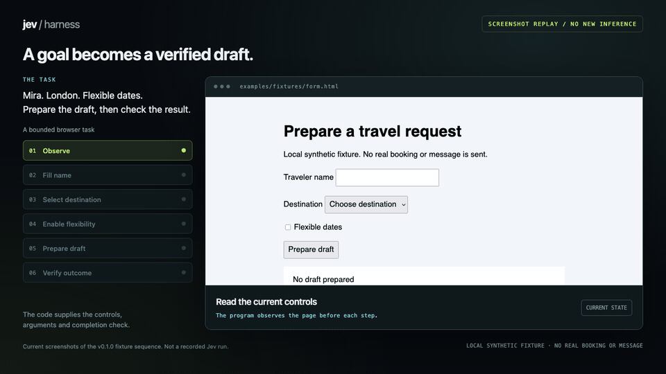
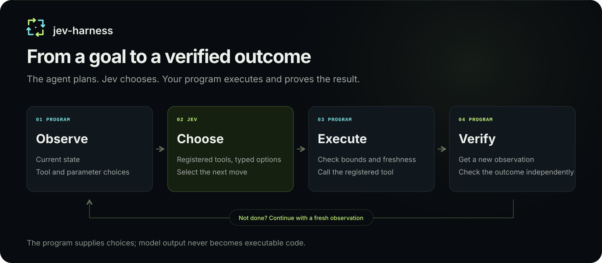

<p></p>

# Jev Harness

[简体中文](README.zh-CN.md) · [Documentation](https://apixly-ai.github.io/jev-harness/) · [Toolkits](docs/toolkits.md) · [FAQ](docs/faq.md) · [Use cases](docs/use-cases.md) · [Agent contract](docs/agent-contract.md) · [Evidence](reports/README.md)

**Give an open goal. Let AI define the tools. Let Jev explore the next step.**

Jev Harness runs AI-authored task scripts for goals whose route may be unknown. The
primary AI defines tool capabilities, fresh parameter providers, observation and completion
checks. Jev uses the goal, admitted conversation, new state and history to choose the next
tool and arguments. Code executes, refreshes the state and checks completion. Bounds
control permissions and resources while Jev discovers the route from new observations.
An independent Apixly community project. Current runtime: **0.2.1**.

The distribution is **apixly-jev-harness**, the Python namespace is `apixly_jev_harness`,
and `apixly-jev-harness` is an unambiguous CLI alias. Use this repository’s exact Git
installation URL; the PyPI name jev-harness belongs to an unrelated project.

## Open goals are the main use case

The script defines capabilities and checks; Jev decides the exploration path. Pages,
files, resources and dependent arguments can be discovered while the loop runs.

| Goal | AI supplies | Jev decides |
| --- | --- | --- |
| Find three applicable self-hosted tools through an unfamiliar catalog | Open/read/filter/collect/save tools and source checks | Which branch to inspect, which filters to bind, when evidence is sufficient |
| Diagnose a repository issue from source and recorded failure evidence | Allowed file/symbol/artifact tools and source checks | Which relationships and evidence to inspect |
| Diagnose a task through a controlled API | Status/log/dependency/paging tools and independent readback | Which resource or dependency to inspect next |

[Open-goal design and priorities](docs/open-goals.md) · [Case contracts](docs/use-cases.md)

Dynamic providers supply candidates from fresh state; dependent arguments bind in order.
Task scripts can combine browser, source, API and trusted generation tools while reusing
one context, loop, action-history and verification protocol. Follow the links above for
case contracts and acceptance records.

## Historical integration evidence

[Interactive homepage & video](https://apixly-ai.github.io/jev-harness/#browser-evidence) · [Download MP4 replay](web/media/browser-demo.mp4)

[](https://apixly-ai.github.io/jev-harness/#browser-evidence)

This **screenshot replay** uses headless Camofox captures of the original local fixture.
Historical v0.1.0 live Jev acceptance reached the final state in four tool executions;
the independent verifier checked field values and final draft text. Synthetic data; no real bookings or messages.
[Acceptance ledger](reports/README.md) · [Media scope](web/media/README.md)

| Use case | Inputs and choices | Independent check |
| --- | --- | --- |
| Browser travel draft | Mira, London, flexible dates; observed controls and supplied values | Read field values and final draft text |
| Python tools and parameters | Target 3; increment choices 1 or 2 from current state | Observed value reaches target; historical live scaffold acceptance is in the ledger |
| Evidence progress and execution bounds | Observation, admitted results and action ledger | Offline contracts check continuation, review and repeated-action blocking |

<p></p>

Browser and desktop adapters can host your own task tools. Each script supplies its
inputs, dynamic argument candidates and completion checks; the runtime supplies the loop
and result records. Integration details and acceptance records are linked in the docs.

## Reuse tools, write a thin task

Start with `WorkspaceTools` for local files or `WebTools` with HTTP/Camofox acquisition.
An `EvidenceStore` keeps captured text; `EvidenceTask` supplies progressive reads,
labeled quotes and a saved report checked by your verifier. Both
[research](examples/research_task.py) and [workspace](examples/workspace_task.py) examples
are 28-line scripts: runtime inputs supply scope and criteria, while Jev chooses the route.
The [toolkit guide](docs/toolkits.md) covers the shared API and optional MCP access.

Python 3.10+ and Git are required. The runtime pins Jev Filter 0.4.1 from GitHub as its
inference and platform dependency. Installation makes no model calls.

```sh
python -m venv .venv
. .venv/bin/activate
pip install 'git+https://github.com/apixly-ai/jev-harness.git@v0.2.1'
jev-harness spec
jev-harness init-task task.py --toolkit workspace
jev-harness check-task task.py
# Billable: configure TYPESAFE_API_KEY or TYPESAFE_API_KEY_FILE in your environment.
jev-harness run task.py --goal 'Investigate source evidence and save categorized quotes' --inputs '{"root":"permitted-corpus","queries":["relevant_identifier"],"markers":{"implementation":"<source marker>"},"output":"local-results/report.json"}'
```

Use `@main` instead of `@v0.2.1` only for active development. Replace illustrative inputs
with your permitted sources and quote criteria. Marker checks demonstrate the hook;
business correctness belongs in the caller verifier.

For primary-agent integration, expose the same script with
`python -m apixly_jev_harness.mcp task.py --goal ... --inputs ...`. MCP advertises
`observe`, `arguments`, `operate` and `run_task`. Reference-based direct operation and
Jev delegation use the same tools, goal and artifact checks. Choose one route for a
session; arguments and operations carry the current `observe.state_ref` and run in
sequence. See the [interface contract](docs/agent-contract.md#toolkit-and-mcp-interface)
and [acceptance evidence](reports/README.md).

When any command's argument parser reports an error, the CLI returns a fixed
`failed/arguments/invalid_command_arguments` packet and exits 2, with
`script_loaded: false` and `model_calls: 0`. Raw argument values, detailed error text and
usage are omitted, so use `spec`/help to correct the command rather than treating this
as tool failure. Valid help remains human text with exit 0 and its original precedence;
it may precede a later unknown-argument check. Valid long-option abbreviations are
unchanged. See the [argument contract](docs/agent-contract.md#cli-argument-parsing) and
[offline A/B](reports/cli-arguments-ab.json).

`check-task` reads UTF-8, parses and compiles Python, and requires an explicit top-level
assignment to `workflow`; `workflow: object` alone does not bind it. It never executes the
script, loads its module, imports its dependencies or invokes callbacks. Passing does not
prove runtime validity or compatibility with another Python version or warning policy.
See the [static-check contract](docs/agent-contract.md#static-task-checking) and
[offline A/B](reports/static-check-ab.json), which executes no checked scripts and uses
zero models or real UI.

`run` validates JSON inputs/context/messages, goal, bounds and required-context path syntax
before creating or loading the task module. CLI inputs/context must be JSON objects and
messages a JSON list; explicit `null` is rejected. Only omitted/`None` Python API
inputs/context/messages receive defaults. Goal and these fields must serialize as finite JSON and encode as UTF-8;
isolated surrogates are rejected. Invalid configuration returns
`failed/configuration/invalid_run_configuration`, with `script_loaded: false` and
`model_calls: 0`. Valid configuration still imports trusted Python, which can have
top-level effects; this preflight is not a sandbox or runtime-validity check. See the
[preflight contract](docs/agent-contract.md#run-configuration-preflight) and
[offline A/B](reports/run-preflight-ab.json), using synthetic import markers and model-free workflows,
with no actual API or UI calls. Returned runtime packets exit 0 only for `done`, otherwise 2.
Uncertain effects are never auto-retried.

During trusted module creation/import and the loop, CLI `run` discards writes to its
redirected Python stdout/stderr without retaining content. Optional `task_output` reports
only Unicode-character and binary-buffer byte counts; it cannot recover discarded debug
text. Return tool results rather than printing them. This output policy applies only to
`run`; `Engine.run` is unchanged. Redirection is process-global: old stream-bound logging handlers, file
descriptors and subprocess output can bypass it, and concurrent thread output is not
isolated. This is neither a sandbox nor a guarantee that all output is private or valid
JSON. Task-path `SystemExit`/`KeyboardInterrupt` restore streams and become quiet nonzero
CLI exits, with no terminal packet or output counts; reconcile effects and usage.
Help behavior and SDK interrupts are unchanged. See the
[output contract](docs/agent-contract.md#cli-task-output) and
[offline A/B](reports/task-output-ab.json).

## Minimal tool registration example

```python
from apixly_jev_harness import Parameter, Task

state = {"value": 0}
workflow = Task(
    observe=lambda ctx: {"value": state["value"], "target": ctx.inputs["target"]},
    verify=lambda ctx, seen: seen["value"] == seen["target"],
)

@workflow.tool("Advance toward target without overshooting", parameters={
    "amount": Parameter("Amount needed for the next increment", lambda ctx, seen:
                        [n for n in (1, 2) if seen["value"] + n <= seen["target"]]),
}, result_context=lambda result: result)
def increment(amount):
    state["value"] += amount
    return {"value": state["value"]}
```

Domains may be static or derived from the observed state. `depends_on` constructs child
candidates only after parent arguments are selected. `Option(id, description, value)`
separates model-visible semantics from the actual bound value. Singleton domains bind
without inference. Parameters are selected from supplied candidates, never invented.
Task registration preserves dynamic provider identity and its bound client/lock/state,
while deep-copying static choices. Providers are called afresh when a step needs their
domain; results are not cached.

After duplicate-ID/size checks, each complete parameter domain is deep-copied before
selection. Ordinary `Option` values and raw dictionary/list values are isolated from
later source mutation during that selection, preventing a changed value from replacing
the offered one. Providers still run afresh and retain their identity; staged and joint
interfaces remain supported. This is not atomic acquisition, global freshness or a
sandbox. Copying adds time/memory overhead based on all candidate values' object
structure, and an unselected custom deepcopy failure can now stop the task earlier.
Failures and unknown usage are
retained; no speed or fee benefit is promised. See the
[parameter-snapshot A/B](reports/parameter-snapshots-ab.json).

`Task.bind` and `Task.execute` compare a standard `Action` with the latest offered
snapshot using builtin typed fields. Boolean/number substitutions, including nested
keys, no longer pass as equal; finite `1`/`1.0` remains equivalent. This is neither
byte equality nor object identity. Unchanged Enum/str/dict/list subclasses can also be
rejected: normalize values before offering candidates, not after binding. Direct calls
retain existing ValueError codes; Engine bind rejection normally returns `failed`, while
execute rejection can remain `execution_uncertain` even before the tool body. Preserve
prior effects/unknown usage and reconcile rather than retry. Standard Engine does not
actively rewrite Actions; this is a low-level consistency guard, not evidence of a model
attack or general wrong arguments. See the
[contract](docs/agent-contract.md#offered-action-consistency) and
[action-identity A/B](reports/action-identity-ab.json); no quality, speed or fee promise.

Callbacks must declare synchronous behavior; known coroutine, async-generator and
generator callbacks are rejected without invoking their bodies. Synchronous generator
`Workflow.candidates` and explicit blocking wrappers remain supported. Callback-kind
detection follows only partial `.func` chains, without `inspect.unwrap`. Choice providers
must bind two or three positional arguments; optional keyword-only arguments are allowed,
and three wins when both bind. See the [callback contract](docs/agent-contract.md#synchronous-callback-contract)
and [offline A/B](reports/callback-contract-ab.json). These checks cannot prove ordinary
wrapper return types, prevent trusted import effects or turn the runtime into an async
engine or sandbox. The A/B uses scripted decisions with zero real model, network or UI
calls; it establishes no general success, speed or cost benefit.

Choice-provider binding now checks the entry signature with `follow_wrapped=False`,
respecting explicit `__signature__`. Without `*args`, or with at least three explicit
positional slots, that entry governs. Generic forwarding entries with fewer than three
slots retain the advertised delegate contract; the chosen two/three arguments must bind
both signatures, with three preferred. This changes providers only, not `Task.tool`
signatures or callback-kind detection. It does not prove metadata/body behavior or fix
every decorator; use an explicit interface for ambiguous wrappers. See the
[parameter contract](docs/agent-contract.md#parameter-protocol) and
[provider-signature A/B](reports/provider-signature-ab.json).

Tool selection asks for the **next step**. Gathering evidence or satisfying a prerequisite
can advance the task without completing the entire goal in one call. Describe each tool's
preconditions, expected effect and applicable exit or priority rules in the caller's goal
and contracts. The core has no general UI-form ordering rules; candidate position does
not establish priority. The host supplies `decision_stage=tool_selection` or
`parameter_selection` to distinguish loop decisions. Direct `Engine.decide` filtering
without this loop marker retains general candidate-selection semantics. Conditional
parameter binding, authorization, independent verification and exit checks are unchanged.

## Two native interfaces

- **Jev-native:** native Choice answers with probabilities; sequential parameter dependency
  resolution; strict selected-ID binding; abstention and independent completion checks.
- **AI-native:** machine-readable `spec`, a runnable scaffold, offline syntax checking,
  typed Python interfaces and a bundled [agent skill](skills/jev-harness/SKILL.md).
  No hidden hook installation or automatic interception of every agent tool call.

[Context management](docs/context.md) keeps goals/facts/messages, an action ledger,
recent admitted tool results and references to older evidence. Raw evidence stays in
private journals. Loop shared context retains its inclusive 15,000 JSON-character limit,
measured with `json.dumps(..., ensure_ascii=False)` and default separators. Overflow
normally returns `needs_review/context_budget_exceeded` with count-only `context_budget`
stage/limit/observed metadata, without truncation. Returned decision-call telemetry adds
`context_characters` and `context_character_limit` alongside UTF-8 `context_bytes`.
These units differ; candidate texts, selection questions, full prompts and token/cost
budgets are outside this cap. Direct `Engine.decide` keeps its existing upstream limits.
Prior calls or effects may already exist. See the [budget contract](docs/agent-contract.md#loop-context-budget)
and [offline A/B](reports/context-budget-ab.json) for scope and negative results.

An admitted tool-result summary can advance the next decision even when the observation
is unchanged. Raw results without `result_context` admission cannot advance that state.
Within one run, the same observation, action ID and actual bound parameters may execute
only once; a repeated invocation stops before execution with `blocked/repeated_action_state`.
Polling the same call against a fixed observation is unsupported. Handle polling inside
a tool with its own bounds, or expose meaningful observed progress.

Unresolved selection may return a host-generated `diagnostic` identifying
`tool_selection` or `parameter_selection`, registered tool/parameter identifiers for
the latter, allowlisted `reason_codes` and `automatic_retry: false`. Each selection
entry in `telemetry.calls` carries its stage and applicable identifiers. The
[contract](docs/agent-contract.md#decision-diagnostics) explains the codes and primary-agent
handoff; exceptions, response bodies and bound values are not exported in diagnostics.
Static domain, policy and execution errors keep their existing terminal reasons.
Diagnostics do not change eligibility, status or authorization. The harness does not
repeat task calls automatically; the pinned SDK's bounded 429/503/529 retries remain,
so this is not a one-network-request guarantee.

An empty native choice plan now carries optional `telemetry.planning` (or loop
`telemetry.calls[].planning`): scope `current_selection`, phase `request_planning`,
`inference_dispatched: false` and fixed reason codes. It distinguishes required context
from input needing narrowing without inventing an unknown cause. The existing known-zero
usage applies to that selection; earlier loop calls, effects or unknown usage may remain.
Use the diagnostic stage to repair candidates/descriptions or required fields while
preserving goal and safety constraints. There is no blind retry, new cap or changed model
choice. See the [planning contract](docs/agent-contract.md#request-planning-handoff) and
[offline A/B](reports/planning-diagnostics-ab.json); these do not establish semantic
accuracy, speed or fee savings.

Browser and desktop are [tool adapters](docs/adapters.md), not application-specific
programs in the runtime. Camofox uses fresh observed targets and allowed origins;
desktop uses pinned macOS Accessibility/Windows UIA backends. Caller policy authorizes
exact click actions; scripts must own business identity and idempotency.

## Verification, not promises

The `verify_state` helper requires nonempty text or at least one control condition.
Its typed matching was introduced as a helper-only change in 0.1.14; the later offered
action guard reuses its internal comparison without changing helper behavior.
Every expected control field must be observed; a missing field does not establish `null`.
Control values now use recursive builtin-type matching: booleans differ from numbers,
while finite `1`/`1.0` numeric equivalence remains. Lists/tuples match only their own kind,
and dictionary keys retain boolean/number distinctions. Unsupported types/subclasses
do not match; complex comparisons belong in caller-owned `verify`. Text checks require
observed builtin strings, without list/dictionary membership. Expected text accepts only
`None`/builtin `str`; invalid types/subclasses raise the existing configuration error.
Rejecting an old false
`done` can allow later tools and additional decisions; it is not a speed or fee benefit.
See the [typed-verification A/B](reports/verification-types-ab.json). Custom verification,
global input admission, execution permissions and candidate refresh/no caching are unchanged.
The [evidence-progress A/B](reports/evidence-progress-ab.json) uses synthetic offline
decisions to check result-driven continuation and repeated-call blocking. It is not live
model acceptance or evidence of general performance gains.

The [decision-diagnostics A/B](reports/decision-diagnostics-ab.json) uses synthetic
offline HTTP mocks with zero real model calls. It checks actionable codes and stage
metadata; it adds terminal bytes, unknown errors fall back to generic codes, and real
semantic recovery success has not been measured.

[Tool-choice offline A/B](reports/tool-choice-offline-ab.json) and
[tool-choice live A/B](reports/tool-choice-live-ab.json) cover six development synthetic
single-decision cases with normal and reversed candidate order. The probe stops before
intent, so these reports cannot prove full-task, browser or desktop completion. Read the
reports for measured outcomes and usage; no general quality or cost benefit is established.

A live Jev/Camofox synthetic form reached the independently checked final state in
four tool executions. Early attempts requiring review are retained. Desktop live
acceptance is **not yet proven**: this host is locked; offline adapter tests do not
replace native acceptance. [Exact evidence and limits](reports/README.md).

No result cache. Independent inference concurrency is capped at 30. Synchronous wall
budgets use cooperative checkpoints; tools must bound their own I/O. At the top of a loop
cycle, after verification returns false, the loop checks `max_steps` first, then checks
elapsed time before starting `workflow.candidates`. If that check sees an expired budget,
it stops with
`budget_exceeded`. A true result from that verifier still finishes `done` even if it
arrives late; after false verification, `max_steps` retains priority over this timeout
check. Running callbacks are not interrupted, and this is not a complete
hard deadline. Earlier effects and unknown usage remain. Skipped candidate reads no
longer provide their empty/error diagnostics. See the
[candidate-budget A/B](reports/candidate-budget-ab.json); no general speed or fee benefit
is promised. The runtime
records intent before execution, preserves unknown usage, and does not implement
cross-run resume or exactly-once effects.

An `execution_uncertain` result from `DecisionStop` in the current execution window now
includes the current bound `action_id` when available. Use it to locate private journal
evidence and reconcile the target; it proves no success or execution count and is neither
an idempotency key nor permission to rerun. No bound arguments are added to the terminal;
unknown usage remains unknown. See the [identity A/B](reports/execution-identity-ab.json).

Optional `telemetry.owned_transport` now reports the run's owned provider-client counter
deltas at terminal finish: SDK request attempts (including retries), created HTTP client
objects and client reuse. Existing `telemetry.requests` and per-call transport evidence
are unchanged; native Choice reports logical packed requests. A logical request can have
three attempts after retries, or none when credentials fail. Missing/unreliable counters
are `null`; absent metadata is unknown, not zero. These counters prove neither HTTP/server
receipt, inference or billing nor TCP connections or other tool traffic. See the
[counter contract](docs/agent-contract.md#transport-counters-owned-by-the-run) and
[A/B scope](reports/transport-counters-ab.json). Unknown usage remains unknown.

## Development

```sh
pip install -e '.[dev]'
ruff check src tests benchmarks scripts
pytest --cov=apixly_jev_harness
python -m build
python scripts/check_public.py
```

See [architecture and references](docs/architecture.md). Live tests are opt-in, billable
and use synthetic/permitted inputs plus an explicitly supplied credential. Contributions
must retain negative results and distinguish mock, live and production evidence.
