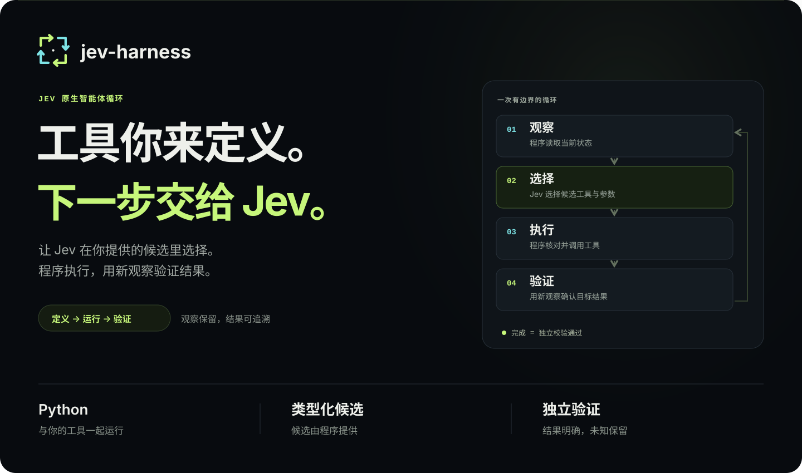
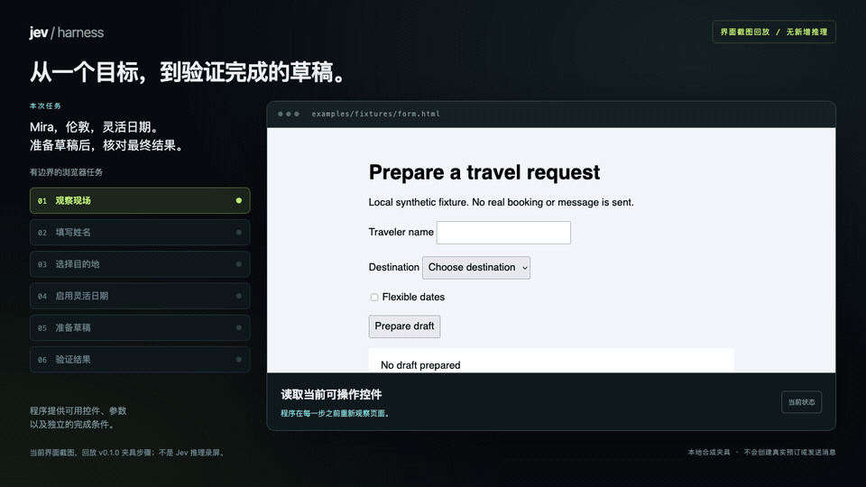
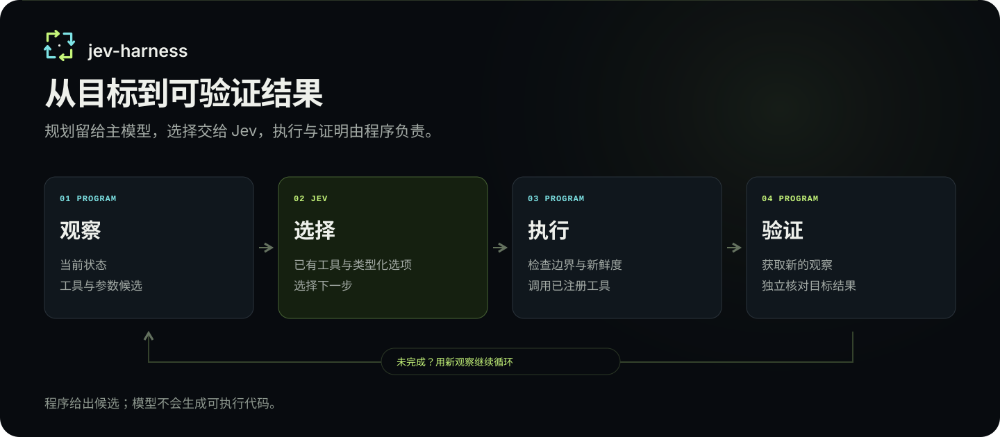

<p></p>

# Jev Harness

[English](README.md) · [文档](https://apixly-ai.github.io/jev-harness/zh/) · [常见问题](docs/faq.zh-CN.md) · [使用案例](docs/use-cases.zh-CN.md) · [AI 接口](docs/agent-contract.zh-CN.md) · [验收证据](reports/README.zh-CN.md)

**编写任务，注册工具，让 Jev 选择下一次调用和参数。**

这是面向 AI 编写有界任务脚本的 Python 运行时。每轮提供目标、准入对话、现场、执行
历史和工具契约，Jev 选择工具与参数候选，程序执行并独立验证完成。Apixly 独立社区
项目，非 TypeSafe AI 官方产品。早期 0.1.15，不承诺通用任务成功或普遍降低费用。

发行名 **apixly-jev-harness**，Python 命名空间 `apixly_jev_harness`，明确 CLI 别名
`apixly-jev-harness`。使用本仓库的准确 Git 安装 URL；PyPI 的 jev-harness 属于其他项目。

## 看看执行过程

[查看交互主页与视频](https://apixly-ai.github.io/jev-harness/zh/#showcase) · [下载 MP4 回放](web/media/browser-demo.zh-CN.mp4)

[](https://apixly-ai.github.io/jev-harness/zh/#showcase)

这是无头 Camofox 对原始本地夹具的**截图回放**，没有新增模型调用；历史 v0.1.0
Jev 浏览器验收以 4 次工具执行达到最终状态。两者分别标注，不将回放当作新的推理录屏。
合成数据，不创建真实预订或发送消息。[验收记录](reports/README.md) · [素材说明](web/media/README.md)

| 使用场景 | 输入与候选 | 独立验证 |
| --- | --- | --- |
| 浏览器旅行草稿 | Mira、London、灵活日期；观察到的控件和程序提供的值 | 回读字段，并核对最终草稿文本 |
| Python 工具与参数 | 目标值 3；从当前状态生成递增候选 1 或 2 | 观察值达到目标；历史真实生成任务验收见账本 |
| 结果进展与执行边界 | 观察、准入工具结果与动作账本 | 离线契约验证继续执行、复核与重复动作阻断 |

<p></p>

浏览器和桌面适配器可以承载自己的任务工具；**原生桌面完成仍未验证**。
具体输入、参数候选和完成条件由任务脚本负责。主页的代码与边界图标注为示意或离线案例。

## AI 从接口开始

需要 Python 3.10+ 和 Git。底层依赖固定为 GitHub 的 Jev Filter 0.4.1，安装不调用模型。

```sh
python -m venv .venv
. .venv/bin/activate
pip install 'git+https://github.com/apixly-ai/jev-harness.git@v0.1.15'
jev-harness spec
jev-harness init-task task.py
jev-harness check-task task.py
# 付费：在环境中配置 TYPESAFE_API_KEY 或 TYPESAFE_API_KEY_FILE。
jev-harness run task.py --goal '达到指定目标' --inputs '{"target":3}'
```

仅在开发时将 `@v0.1.15` 换成 `@main`。

任一命令的参数 parser 报错时，CLI 返回固定的
failed/arguments/invalid_command_arguments packet，退出码为 2，并标记
script_loaded: false、model_calls: 0。不输出参数原值、详细错误或 usage；应参考
spec/help 修正命令，不将其视为工具失败。合法 help 仍是人类文本、退出码 0，保留原
优先次序，可能先于后续未知参数检查退出。有效的长选项缩写不变。见
[参数解析契约](docs/agent-contract.md#cli-argument-parsing) 与
[离线 A/B](reports/cli-arguments-ab.json)。

check-task 以 UTF-8 读取、解析并编译 Python，要求顶层显式向 workflow 赋值；
单独的 workflow: object 注解不绑定它。不执行待检脚本、不加载其模块、不导入其依赖，
也不调用回调。通过不证明运行时有效，或兼容其他 Python 版本及警告策略。
见[静态检查契约](docs/agent-contract.md#static-task-checking) 与
[离线 A/B](reports/static-check-ab.json)，不执行待检脚本，无模型或真实 UI 调用。

run 在创建或加载任务模块前，校验 JSON inputs/context/messages、目标、预算边界与
required-context 路径语法。CLI 的 inputs/context 必须是 JSON object，messages 必须是
JSON list，显式 null 被拒绝；只有 Python API 省略或 None 的 inputs/context/messages
才使用默认值。
目标及这些数据必须可序列化为有限 JSON 并编码为 UTF-8，孤立 surrogate 被拒绝。
配置无效时返回 failed/configuration/invalid_run_configuration，
并标记 script_loaded: false、model_calls: 0。合法配置仍会导入可信 Python，可能产生
顶层效果；预检不是沙箱，也不验证运行时有效性。见
[预检契约](docs/agent-contract.md#run-configuration-preflight) 与
[离线 A/B](reports/run-preflight-ab.json)，使用合成导入标记与无需模型的工作流，无真实 API 或
UI 调用。正常返回的运行结果中，只有 done 退出码 0，其余为 2。不确定效果不自动重试。

CLI run 在创建/导入可信模块及 loop 期间，丢弃写入其重定向 Python stdout/stderr 的
内容，不保留原文。可选 task_output 只记录 Unicode 字符及二进制 buffer 字节计数，
无法恢复被丢弃的调试原文；工具应返回结果，不通过 print 传递。该输出策略只用于
run，Engine.run 不变。重定向作用于整个进程：保存旧 stream 的日志 handler、文件描述符和
子进程输出可绕过它，并发线程的输出也不隔离。这不是沙箱，不保证所有输出私密或
可解析为 JSON。任务路径内的 SystemExit/KeyboardInterrupt 恢复 stream 后转换为安静的
非零 CLI 退出，不返回终态 packet 或输出计数；效果与用量仍须核对。
Help 行为及 SDK 中断不变。
见[输出契约](docs/agent-contract.md#cli-task-output) 与
[离线 A/B](reports/task-output-ab.json)。

## 工具和参数语义

```python
from apixly_jev_harness import Parameter, Task

state = {"value": 0}
workflow = Task(
    observe=lambda ctx: {"value": state["value"], "target": ctx.inputs["target"]},
    verify=lambda ctx, seen: seen["value"] == seen["target"],
)

@workflow.tool("向目标前进且不超过目标", parameters={
    "amount": Parameter("下一次递增的数量", lambda ctx, seen:
                        [n for n in (1, 2) if seen["value"] + n <= seen["target"]]),
}, result_context=lambda result: result)
def increment(amount):
    state["value"] += amount
    return {"value": state["value"]}
```

候选可静态声明或从现场生成。depends_on 让子参数在父参数选定后再构造候选；
Option(id, description, value) 分离模型可见语义与实际值。只有一个候选时直接绑定，
其余由 Jev 选择，不凭空生成参数。
Task 注册保留动态 provider 身份及绑定的 client/lock/state，静态候选仍深拷贝。
每步需要其候选域时重新调用 provider，不缓存结果。

重复 ID/数量检查后，每次完整参数候选域在交给选择前深拷贝。普通 Option 值及
原始 dict/list 值与该次选择期间的后续来源修改隔离，避免实际绑定值被改成另一份。
Provider 仍重新调用并保留身份，默认 staged 与 joint 接口仍支持。这不是原子采集、
全局 freshness 或沙箱。复制按全部候选值的对象结构增加时间/内存开销，未选候选的
自定义 deepcopy 失败也可能更早停止任务。失败和未知用量保留，不承诺提速或省费。见
[参数快照 A/B](reports/parameter-snapshots-ab.json)。

回调必须声明为同步；已知 coroutine、async-generator 和 generator 回调会在不调用
函数体的情况下被拒绝。Workflow.candidates 的同步 generator 和显式阻塞包装仍支持。
回调类型检测只展开 partial 的 .func 链，不使用 inspect.unwrap。
候选 provider 必须可绑定两个或三个位置参数，允许可选 keyword-only 参数；两种都可
绑定时优先三个。见[回调契约](docs/agent-contract.md#synchronous-callback-contract) 与
[离线 A/B](reports/callback-contract-ab.json)。这些检查不能证明普通 wrapper 返回类型、
阻止可信导入的效果，也不把运行时变成异步引擎或沙箱。A/B 使用 scripted decisions，
真实模型、网络和 UI 调用为零；未证明普遍成功、提速或降费收益。

候选 provider 的绑定现在以 follow_wrapped=False 检查入口签名，尊重显式
__signature__。没有 *args，或至少有三个显式位置槽位时，由入口签名决定；少于三槽
的通用转发入口保留 advertised 委托契约，所选两/三参数须同时可绑定两个签名，三优先。
只改变 provider，不改变 Task.tool 签名或回调类型检测，不证明元数据/函数体行为，
也不保证修好每个 decorator。模糊包装器应采用明确接口。见
[参数契约](docs/agent-contract.zh-CN.md#parameter-protocol) 与
[provider 签名 A/B](reports/provider-signature-ab.json)。

工具选择针对**下一步**。取证或满足前置条件可以推进任务，不要求一次调用完成总目标。
由调用方在目标和契约中描述每个工具的前置条件、预期效果，以及适用的退出或优先级规则。
核心没有通用 UI 表单次序规则；候选列表的位置不构成优先级。Host 提供
decision_stage=tool_selection 或 parameter_selection 区分 loop 判断。
直接使用 Engine.decide 筛选候选且不带这个 loop 标识时，保留一般候选选择语义。
参数条件化、授权、独立验证和退出检查保持不变。

## 两种原生接口

- Jev-native：原生 Choice 概率、参数依赖解析、严格引用绑定、弃权与独立完成验证。
- AI-native：机器可读 spec、可运行模板、离线语法检查、Python 接口与随包提供的
  [agent skill](skills/jev-harness/SKILL.md)，不偷偷安装 hook 或拦截全部工具调用。

[上下文管理](docs/context.md) 保留目标、事实、对话、动作账本、近期准入结果与较早
证据引用。原文留在私有日志。Loop 共享上下文保留含上限的 15,000 JSON 字符限制，
按 json.dumps(..., ensure_ascii=False) 和默认分隔符计量。溢出通常返回
needs_review/context_budget_exceeded，附仅含计量信息的 context_budget 阶段/上限/观测值，
不自动截断。返回的决策调用遥测新增 context_characters、context_character_limit，
保留 UTF-8 context_bytes。单位不同；候选文本、选择问题、完整 prompt 及 token/费用
预算不在此上限内。直接 Engine.decide 保留已有上游限制；此前可能已有调用或效果。
见[预算契约](docs/agent-contract.md#loop-context-budget) 与
[离线 A/B](reports/context-budget-ab.json) 的范围与负面结果。

准入的工具结果摘要可以在观察不变时推进下一轮判断。未经 result_context 准入的
原始结果不能推进这种状态。同一次运行中，相同观察、动作 ID 和实际绑定参数最多
执行一次；重复调用在执行前返回 blocked/repeated_action_state。
不支持观察固定时反复轮询相同调用；应在有界工具内部处理轮询，或暴露有意义的现场进度。

未能确定选择时，可能返回由 host 生成的 diagnostic，标明 tool_selection 或
parameter_selection，后者附注册工具/参数标识，以及白名单 reason_codes 和
automatic_retry: false。telemetry.calls 的每次选择记录也带阶段及适用的标识。
[契约](docs/agent-contract.md#decision-diagnostics) 说明原因码与主 AI 接管建议；
诊断不导出异常原文、响应 body 或绑定值。静态候选域、策略和执行错误保留已有终态原因。
诊断不改变执行资格、退出状态或授权。Harness 不自动重复任务调用，固定 SDK 已有的
有界 429/503/529 重试仍保留，因此不承诺只发一次网络请求。

原生 choice 请求计划为空时，新增可选 telemetry.planning（loop 中为
telemetry.calls[].planning）：scope current_selection、phase request_planning、
inference_dispatched: false 和固定原因码，区分缺少必需上下文与需要收窄的输入，
不猜测未知原因。已有的已知零用量只适用于这次选择，此前可能已有 loop 调用、效果
或未知用量。应按 diagnostic 阶段修正候选/描述或必需字段，并保留目标与安全约束。
不盲目重试，不新增上限或改变模型选择。见
[规划契约](docs/agent-contract.zh-CN.md#request-planning-handoff) 与
[离线 A/B](reports/planning-diagnostics-ab.json)；它们不能证明语义准确率、提速或降费。

浏览器和桌面是[工具适配器](docs/adapters.md)，不是运行时里的专用业务程序。
Camofox 限定来源并使用新鲜观察目标，桌面依赖 macOS Accessibility/Windows UIA。
调用方授权确切点击动作；身份、业务幂等由脚本负责。

## 验证范围

verify_state 辅助函数必须有非空文本或至少一个控制条件。每个预期控制字段都必须
被观察到，字段缺失不等于观察到了 null。
控件值改用递归的 builtin 类型匹配：布尔与数字不同，有限数字 1/1.0 仍相等；list/
tuple 只匹配同类，字典 key 也区分布尔/数字。不支持的类型/子类不匹配，复杂比较应由
调用方 verify 实现。检查文本时，观察必须是 builtin str，不用 list/dict 成员关系。
预期文本只接受 None/builtin str，其他类型/子类会产生原有配置错误。
拒绝旧的错误 done 可能继续调用工具和决策，不代表提速或降费。见
[类型验证 A/B](reports/verification-types-ab.json)。自定义验证、全局输入准入、执行权限
及候选刷新/无缓存不变。
[证据进展 A/B](reports/evidence-progress-ab.json) 使用合成离线判断，验证结果驱动的
继续执行和重复调用阻断；不代表真实模型验收或普遍性能收益。

[决策诊断 A/B](reports/decision-diagnostics-ab.json) 使用合成离线 HTTP mock，真实模型
调用为零，验证原因码和阶段信息；终态字节增加，未知错误退化为通用码，尚未测量真实
语义恢复成功率。

[工具选择离线 A/B](reports/tool-choice-offline-ab.json) 与
[工具选择真实调用 A/B](reports/tool-choice-live-ab.json) 的范围是六个开发用合成单步
决策 case，分别使用正序和反序候选。Probe 在 intent 前终止，不能证明完整任务、浏览器
或桌面完成。测量结果和用量以报告为准，未证明普遍质量或费用收益。

真实 Jev/Camofox 合成表单以四次工具执行达到独立校验终态，早期复核失败保留。
桌面真实验收尚未证明：本机锁屏阻止了访问，离线测试不能替代。见[完整证据](reports/README.md)。

无结果缓存，独立推理并发最多 30。同步预算在回调之间检查，工具需自限 I/O。
执行前写 intent，未知用量不计零，不提供跨运行恢复或 exactly-once 保证。

当前执行窗口中由 DecisionStop 产生的 execution_uncertain，在当前已绑定 action_id
存在时会携带它，供定位私有日志并核对目标状态。它不证明效果成功或执行次数，也不是
幂等 key 或重跑许可。终态不新增绑定参数，未知用量仍为未知。见
[动作标识 A/B](reports/execution-identity-ab.json)。

新增可选 telemetry.owned_transport，在终态 finish 时报告本次拥有的提供方 client
计数差值：SDK 请求尝试（包括重试）、创建的 HTTP client 对象及复用次数。已有
telemetry.requests 和逐次调用的 transport 证据不变；原生 Choice 报告逻辑打包请求。
一个逻辑请求重试后可有三次尝试，也可能因凭据失败而没有尝试。缺失/不可靠计数为
null；元数据缺省是未知，不是零。这些计数不证明 HTTP/服务端收到请求、推理或计费，
也不代表 TCP 连接或其他工具流量。见
[计数契约](docs/agent-contract.zh-CN.md#transport-counters-owned-by-the-run) 与
[A/B 范围](reports/transport-counters-ab.json)。未知用量仍为未知。

## 开发

```sh
pip install -e '.[dev]'
ruff check src tests benchmarks scripts
pytest --cov=apixly_jev_harness
python -m build
python scripts/check_public.py
```

见[架构与参考](docs/architecture.md)。真实测试需 opt-in、显式测试凭证及合成/允许输入；
保留负面结果，区分 mock、真实测试与生产证据。
